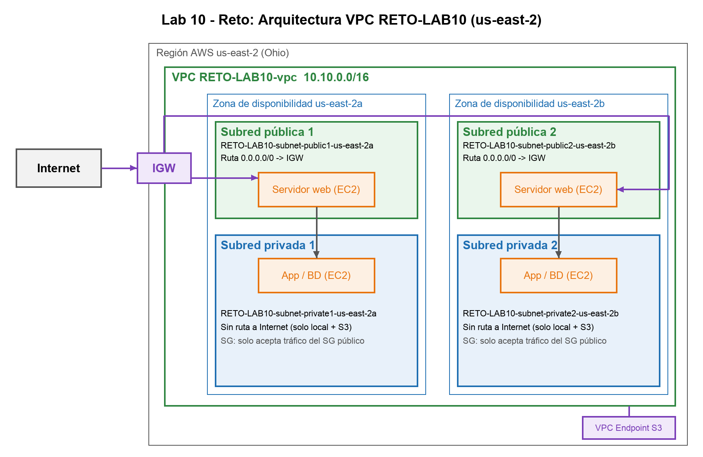

# Lab 10 - VPC en AWS

**Curso:** Desarrollo de Soluciones en la Nube - Tecsup 2026-II
**Integrante:** Harold David Salvador Zarate

## Parte 01: Creación de VPC

VPC `LAB10-vpc` creada con "VPC y más" en la región us-east-2 (Ohio), ya que la región de São Paulo está bloqueada en la cuenta del laboratorio.

| Recurso | Valor |
|---|---|
| VPC | 192.168.0.0/22 |
| Subred pública | 192.168.0.0/24 (251 IP utilizables) |
| Subred privada | 192.168.2.0/23 (507 IP utilizables) |
| Zonas de disponibilidad | 1 (us-east-2a) |
| Gateway NAT | Ninguna |
| Punto de enlace | Gateway de S3 |

## Parte 02: Revisión de la configuración

| Entregable | Captura |
|---|---|
| 01 - Mapa de recursos | [03_E01_mapa_recursos.jpg](capturas/03_E01_mapa_recursos.jpg) |
| 02 - Subredes | [pública](capturas/04_E02_subred_publica.jpg), [privada](capturas/05_E02_subred_privada.jpg) |
| 03 - Tablas de enrutamiento | [pública](capturas/06_E03_rtb_publica.jpg), [privada](capturas/07_E03_rtb_privada.jpg) |
| 04 - Internet Gateway | [08_E04_internet_gateway.jpg](capturas/08_E04_internet_gateway.jpg) |
| 05 - Puntos de conexión | [09_E05_endpoint_s3.jpg](capturas/09_E05_endpoint_s3.jpg) |
| 06 - Seguridad | [grupo de seguridad](capturas/10_E06_security_group.jpg), [ACL de red](capturas/11_E06_acl_red.jpg) |

AWS reserva 5 direcciones por subred: una /24 deja 256 - 5 = 251 IP y una /23 deja 512 - 5 = 507 IP.

## Reto

VPC `RETO-LAB10-vpc` (10.10.0.0/16) con 2 zonas de disponibilidad, 2 subredes públicas y 2 privadas.

- Las subredes públicas usan una tabla con la ruta 0.0.0.0/0 hacia el Internet Gateway.
- Cada subred privada tiene su propia tabla sin ruta a Internet (solo local y S3 por el endpoint).
- [scripts/reto_ec2.sh](scripts/reto_ec2.sh) contiene la prueba con instancias EC2 (servidor web público e instancia privada sin IP pública).

## Videos

- [Parte 01 y 02](videos/Lab10_Parte1_Parte2_VPC.mp4)
- [Reto](videos/Lab10_Reto_VPC.mp4)

## Limpieza

Al finalizar se eliminaron las VPC `LAB10-vpc` y `RETO-LAB10-vpc` con todos sus recursos (subredes, tablas de enrutamiento, Internet Gateways y puntos de enlace) para evitar cobros. Este repositorio no contiene credenciales ni claves de acceso.
